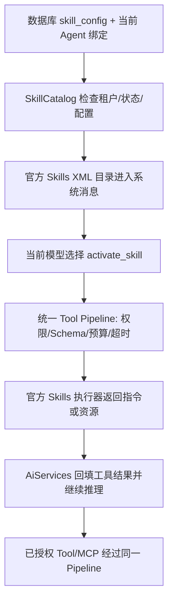

# Skill 官方框架迁移

2026-10-08 接入与当前 Core 1.20.2 配套的 `langchain4j-skills:1.20.2-beta30`。这是官方实验性模块，不宣称已升级到整个框架最新版本。原自定义 Skill 接口、DynamicSkill、SkillManager、AgentSkillToolService，以及仅供旧技能使用的 McpContext/McpContextManager 六个类已经删除。模型网关同步删除无调用方的 callModelWithContext，保留原有官方 Hook 和公共模型治理。

## Skill 是操作指引，Tool 是实际动作

旧实现：`useSkill(skillId, query)` 创建额外模型上下文，拼接 Prompt/步骤，还可能直接请求 Skill 配置的 HTTP API，然后另调一次模型。

新实现：模型看到已授权技能的简短目录，根据任务调用 `activate_skill`，官方执行器返回操作指引；需要时调用 `read_skill_resource` 读取步骤资料。当前 Agent 按指引继续推理，真正计算、查询或外部访问仍调用已授权 Tool/MCP。激活本身不请求模型或 HTTP，不创建子 Agent。

## 从哪里读代码

1. `SkillCatalog`：将数据库配置映射到官方 `Skill` 和 `SkillResource`，调用 `Skills.builder`、`formatAvailableSkills`、`toolProvider`。
2. `AgentToolRegistry`：官方工具规格和执行器注册为 LOW、只读、幂等、无自动重试的受治理工具，没有复制 SDK Schema/解析器。
3. `AgentToolCandidateSelector` / `ModelSemanticRequestRouter`：选择激活/资源工具，需要执行时同时选择业务工具；候选白名单没有扩大。
4. `ConfigurableAgentExecutor.boundSkillInstructions`：系统消息只放本次可用技能的简短目录。
5. `AgentChatService` / `GovernedToolSession`：通过 `AiServices.toolProvider` 提供受治理执行器，框架负责同步/Flux 的工具结果回填和多轮调用。

| 数据库字段 | 官方类型/含义 |
|---|---|
| skillId | Skill.name，稳定 ID，模型精确引用 |
| name + description | Skill.description，保留中文显示名和用途 |
| promptTemplate | Skill.content，Markdown 操作指引 |
| steps | SkillResource.content，路径固定为 references/steps.md |
| enabled / tenantId / Profile 绑定 | 项目授权约束，由服务端执行，不交给模型判断 |

步骤是资料文本，不是 Agentic 的可执行工作流。旧 `{{query}}/{{data}}` 兼容为“当前用户问题/当前对话已提供或经授权工具取得的数据”，不再把完整问题另拼给独立模型。改名不影响 UUID 绑定，相同中文名字也不会相互覆盖。

官方资源工具只读取预加载资源的精确相对路径，不给模型访问任意本地文件的能力。这轮仅映射现有步骤字段，没有引入脚本执行、任意附件目录或文件系统导入。

## 保留治理，而不是复制框架

Skills 提供指令/资源类型、XML 目录、工具 Schema 和工具执行器；项目只处理数据库、绑定、租户及治理适配。执行时重新读取数据库，停用、删除和旧 API 状态立即影响后续读取，不需要启动注册表、多实例同步或 CRUD 缓存更新。管理列表的旧 Redis 缓存也已撤掉，避免旧 DTO 返回过时状态或旧 Headers；原有缓存键不再读取，按旧 TTL 自行过期，未对 Redis 执行删除。已经进入对话/Checkpoint 的旧指令不会被回溯删除，业务动作仍须当前工具授权。

框架的 Skill ToolExecutor 必须调用 `executeWithContext`，其旧 `execute` 方法会抛异常；本轮临时实际执行检查发现并修正了这一点。工具结果继续经过原脱敏、长度限制和预算，真实调用费用由当前 Agent 的模型治理统计。激活没有独立模型费用，新执行不再产生旧 Skill 单独调用的 Token 归属记录，历史技能消耗仍可查询。

本轮不配置 Skill 自带的 `toolProviders` 自动增发工具。官方 `activated_skill` 元数据的主要用途是控制技能范围工具的动态暴露；当前没有这条授权路径，因此安全工具文本足以保留操作指引。审批 Checkpoint 保存该文本，恢复重建原工具白名单，`DurableToolContinuation` 继续推理，不重新激活已读技能或重放已批准动作；后续仍可读取当前可用资源。

Supervisor 整图持久化尚未实现的既有限制不变。审批学习验收请选择 TOOL_CALLING 引擎、由主助手直接申请审批。

## 如何验收

在“技能管理”新建：

- 名称：计算复核。
- 描述：进行数值计算并复核结果。
- 技能指令：`先阅读 references/steps.md。对当前问题使用已授权 calculate 工具计算，核对结果后简洁回答；无数据时要求补充，禁止编造。`
- 步骤资料：`1. 确认算式。2. 调用 calculate。3. 复核并给出结果。`

在个人 Agent 设置中同时绑定该 Skill 和 `calculate`，选自主决策或 ReAct，发新请求：`请用计算复核技能算一下 (120 + 80) * 0.9，并复核结果。`

预期轨迹为 `activate_skill -> read_skill_resource -> calculate -> 回答`，结果 180。模型选择可能有所不同，真实验收须查看 Router 候选及工具轨迹，不能仅凭最终数字判断 Skill 已使用。断点放在 `SkillCatalog.instructions/execute`、`AgentToolExecutionPipeline.executeAdmitted` 和 `GovernedToolSession.execute`。

再在管理页停用 Skill，重新发送请求：该 Skill 不应进入新目录，猜测其 ID 也不能读取正文。重新启用后改中文名称，绑定稳定 ID 不变。未绑定技能或只绑定技能而没有 calculate，不应得到计算工具执行证据。

如果旧 Skill 配置了 API/Headers，管理页显示待迁移原因，能力选择不可用。先将外部请求迁为已注册 Tool 或已配置 MCP 工具，修改技能指令并为 Agent 绑定相关工具，然后在编辑页清空“旧 API 地址”并保存；同时清除旧 Headers。不要直接清空后把缺失的外部执行当成已经迁移完成。旧 Headers 不再经管理响应返回，数据库旧字段尚未 DROP，保留人工迁移依据。

本轮本机 SDK/治理检查使用模拟模型、仓储和审批持久化，是真实 AiServices/Skills/Pipeline 调用；不等价于真实厂商意图选择、业务数据库事务、浏览器审批验收。记录见 `openspec/changes/official-skills-runtime/verification.md`。

官方参考：https://docs.langchain4j.dev/tutorials/skills/ 。官方网页示例可能已经升版，本项目使用匹配 1.20.2-beta30 源码核对过的 API。
