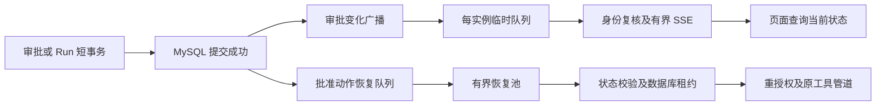

# 审批事件与状态订阅

2026-10-10 本批把聊天页每 2.5 秒读取 Run 的逻辑替换为审批状态通知，并让管理员页自动刷新新申请和执行状态。复用 Spring AMQP、Reactor Flux、Spring MVC SSE、MyBatis 事务和原数据库租约，不增加另一套审批执行器。

## 两条消息链路

广播 `data-agent.approval-events` 是 Fanout Exchange，每个实例有自己的 AnonymousQueue，避免单个竞争消费队列只把通知发给部分实例。内部消息只有租户、用户、会话、Run 和审批引用；SSE 仅返回 Run/审批引用，不返回参数、原文、Checkpoint、申请人资料或授权快照。已有详情接口继续负责展示申请人身份。

批准动作进入 `data-agent.approval-resume` 持久 quorum 队列，正文只有审批 ID。消息负责唤醒，接受进入有界恢复池后即可确认，不把 MQ ACK 当作工具完成。消费者重新读取 APPROVED 与 READY/RUNNING，原 Run CAS/租约、当前双方权限和工具幂等控制仍是执行依据。重复消息不扩大执行权限。

## 状态和事务边界

| 变化 | 登记通知的位置 | 页面读取的权威数据 |
|---|---|---|
| 提交、再次提交审批 | suspendForApproval 成功 | 当前 approvalId、WAITING_APPROVAL |
| 批准待执行 | 审批决定 CAS 成功 | APPROVED/READY，Run 仍等待 |
| 开始恢复 | Run 租约领取成功 | RESUMING |
| 完成或失败 | Run 终态事务 | durable 状态、回答或错误摘要 |
| 拒绝、过期、取消等待 | Run 状态转换成功 | REJECTED/EXPIRED/CANCELLED |
| 删除会话 | 会话生命周期事务 | 管理员列表刷新，本人内容访问被拒绝 |

`ApprovalEventPublisher` 只允许在事务中登记，`@TransactionalEventListener` 默认提交后执行，网络发送在独立有界池。回滚不推送伪状态；发送失败也不回滚已经提交的决定。通知可重复、可合并、可乱序，页面每次都读取当前状态，不按到达顺序覆盖状态。

初次等待消息与审批单/Checkpoint 在同一事务保存。Coordinator 删除原来在收尾时重复保存等待消息的分支，避免批准后立即恢复却找不到助手消息或晚到等待文本覆盖结果。再次暂停同事务更新等待消息。本机仍有同 Run 在收尾时不领取恢复租约；Coordinator/恢复 worker 释放注册表后检查当前 READY 审批并补发唤醒。

失败与恢复次数耗尽的提示更新移入终态事务，前端删除等待 400ms 再查询的猜测。非最终提示仍沿用尽力写回，最终状态以 durable Run 为准；成功回答继续要求先保存成功再提交完成。Trace 在独立事务追加，可能晚于状态通知，不能把 Trace 尚未更新理解为操作失败；当前事件历史完整标记仍为 false。

## 页面订阅和授权

- 用户：`GET /api/v1/my/approval-events?sessionId=...`，仅本人可读会话，待审批/恢复中才订阅。
- 审批人：`GET /api/v1/agent-approvals/events`，使用既有审批查看权限和当前租户。新申请、决定和执行变化刷新当前分页及已打开详情。
- 连接建立时读取当前用户启用状态、租户及权限；每条匹配事件发出前再次复核。异步代码使用请求时固化的身份引用，不读取异步线程的 SecurityContext。归档会话可读，删除会话返回无权访问。
- 每实例最多 512 个连接，同租户/用户最多 4 个，每连接缓冲 32 条。阻塞 MyBatis 权限复核使用独立有界调度器；慢消费者溢出会结束订阅，断线/到期/取消释放注册表。
- 心跳每 15 秒，仅用于连接保活，不查库。连接最多 60 秒，客户端重建后接收 ready 再读取状态，补偿漏通知并重验登录。后台没有新增浏览器连接对应的扫库定时器。
- 浏览器通过 fetch 携带 Bearer，不把 JWT 放 URL；解析完整 SSE 帧，支持跨网络块、CRLF、多行 data 和注释心跳。45 秒无数据中断重连，异常指数退避至最多 30 秒加随机抖动。401 触发既有登录失效处理，403 停止重试。
- ready/变更提示以 150ms 合并，读取串行执行，读取期间的新提示保留下一轮。切换会话/离开页面取消订阅；管理员详情取消旧请求，防止迟到覆盖。连接异常保留原状态并显示刷新入口。

用户区分“等待管理员审批”“已批准，等待执行”“恢复执行中”和终态。批量合并可能跳过瞬时中间态，这是当前状态订阅，不保证每个过渡都逐条展示。

## 配置与边界

公共 `app.agent.durable.recovery-interval: PT1M` 控制恢复漏投/失租和审批过期的有限批补偿。`scan-interval: PT15S` 只用于本机活动恢复租约续租，未运行的节点不因此扫恢复候选。审批 TTL 在决定/恢复时即时校验，不能利用分钟级过期展示延迟继续执行。

本批无新表、无新 Flyway 脚本；队列/广播拓扑在应用启动时由 Spring AMQP 声明。前后端要同版更新，RabbitMQ 仍需启动。本批未操作 Docker、业务库或真实模型；此前 V3～V7 是否已执行仍需按实际环境确认。

这不是持久事件日志或完整 Run 断点流，没有 Last-Event-ID 回放、通知 Outbox 或逐事件确认。广播丢失由下一次成功重连重新查询收敛；长时间断网/MQ 不可达不能承诺实时。恢复池接受后进程退出，仍由持久状态和失租补偿接续。普通聊天断线仍沿用原取消语义，持久后台 Run/完整重连与 Supervisor 检查点属于后续批次。

## 人工验收

1. 普通用户绑定酒店沙箱写工具并使用 AUTO/ReAct，输入 `把酒店 HOTEL-1001 的标准间在 2026-11-01 的价格改为 399 元`。确认申请人身份仍可见，用户显示等待审批，管理员停留当前页即可看到申请。
2. 用另一审批账号批准，确认用户自动看到待执行/恢复中/成功，最终回答保存；网络面板无每 2.5 秒 Run 请求，只有建立订阅、变更及重连同步时查询。快速状态过渡允许合并。
3. 分别验证拒绝、取消等待、审批过期、恢复前撤销工具/权限。终态可自动更新，失败不会显示成功，也不会继续执行撤销授权动作。
4. 申请出现后立即批准、多标签重复批准或重复投递恢复 ID。确认没有缺少助手消息、重复注册本机 Run 或晚到等待文本覆盖答案；沙箱唯一键继续防重。恢复再次提交新审批时验证同样路径。
5. 断开浏览器网络后批准，再恢复网络；断开 RabbitMQ 后批准再恢复。确认订阅重新建立、读取当前结果，未领取工作由一分钟补偿或租约过期后恢复，不要求回放期间所有事件。
6. 两个后端实例分别接用户和审批人连接，验证广播跨实例到达。换其他用户/租户或删除会话、禁用用户、撤销审批权限，验证无越权通知和详情读取；权限撤销后匹配事件复核失败，重连拒绝。
7. 反复切换会话/关闭页面，确认连接释放；人为压慢消费者或超过连接上限，确认缓冲有界并断开/拒绝，重连后重新查询，不无限积压。

本批只做源码语法、引用/构造参数、JS/JSX 绑定与导入导出、Mapper 方法/参数及差异静态检查。没有新增测试类，未执行编译、构建、服务启动、真实 MQ/数据库事务/浏览器/模型验收。以上是待执行步骤，不是通过记录。
